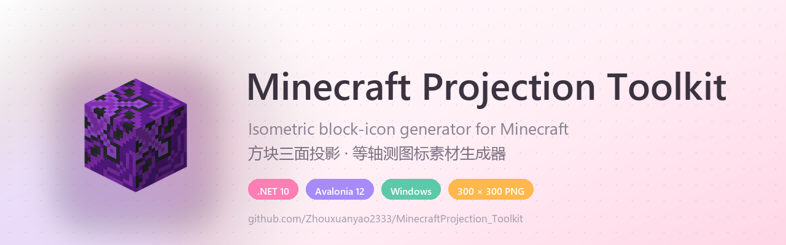
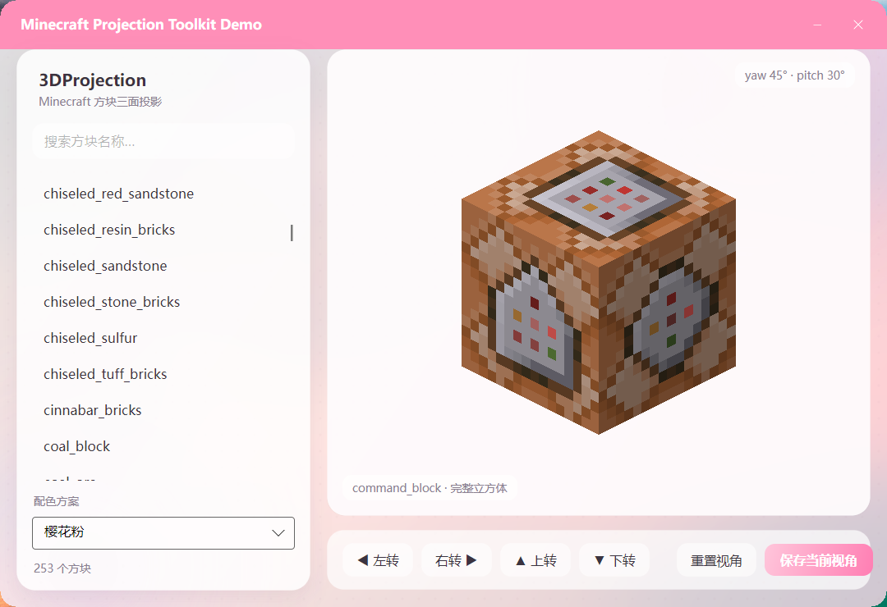
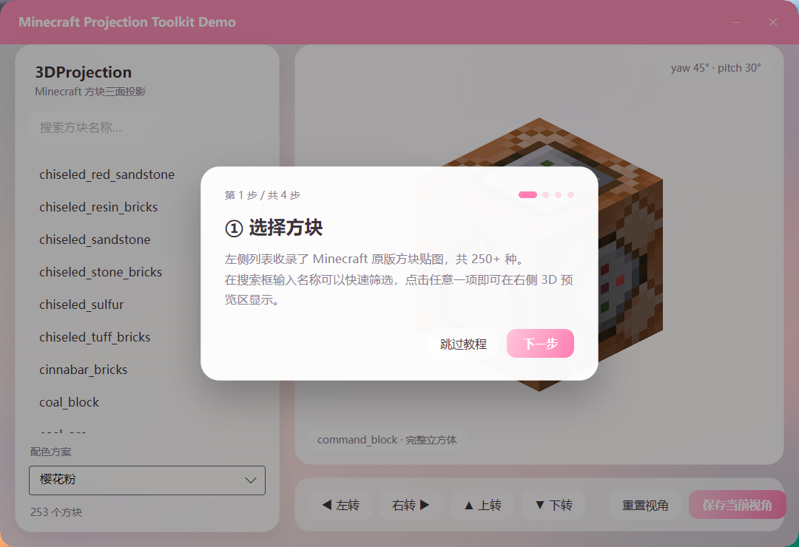
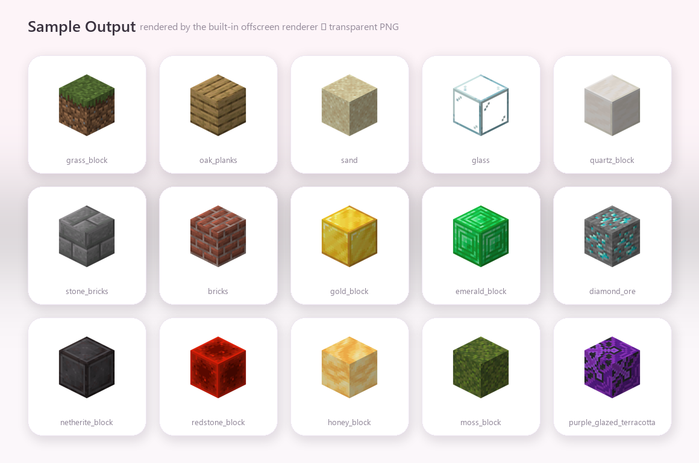
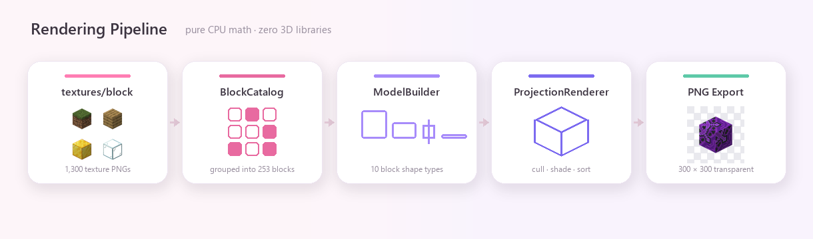

<div align="center">



<h1>Minecraft Projection Toolkit</h1>

<p><b>Turn any Minecraft block texture into a pixel-perfect isometric icon.</b><br/>
Three-face projection · transparent PNG · 300 × 300 · one click.</p>

<p>
  <a href="README.md"><b>English</b></a> &nbsp;·&nbsp; <a href="README.zh-CN.md">简体中文</a>
</p>

<p>
  <a href="https://github.com/Zhouxuanyao2333/MinecraftProjection_Toolkit/stargazers"></a>
  <a href="https://github.com/Zhouxuanyao2333/MinecraftProjection_Toolkit/forks"></a>
  <a href="https://github.com/Zhouxuanyao2333/MinecraftProjection_Toolkit/issues"></a>
  <a href="LICENSE"></a>
</p>

<p>
  
  
  
  
  
</p>

<p>
  <a href="https://github.com/Zhouxuanyao2333/MinecraftProjection_Toolkit/stargazers"></a>
  <a href="https://github.com/Zhouxuanyao2333/MinecraftProjection_Toolkit/issues/new"></a>
  <a href="https://github.com/Zhouxuanyao2333/MinecraftProjection_Toolkit/issues/new?labels=enhancement"></a>
  <a href="README.zh-CN.md"></a>
</p>

</div>

---

## ✨ What is it?

**Minecraft Projection Toolkit** is a desktop tool that renders Minecraft blocks as **isometric, three-face (`top + left + right`) icons** — the exact visual style used by resource packs, launchers, wikis and block catalogues.

Every block gets a **transparent-background PNG** that drops straight into your launcher, website or icon set. No Photoshop, no hand-drawn perspective, no "close enough" downloads.

<table>
<tr>
<td width="50%" valign="top">

**😩 The old way**

- Hand-write a one-off render script → throw it away
- Screenshot someone else's icon → inconsistent style
- Manually composite three faces in an image editor → slow and lossy
- Every new block means repeating the whole process

</td>
<td width="50%" valign="top">

**😎 The toolkit way**

- **253 blocks** ready out of the box, searchable
- Rotation is live — drag to inspect, snap 90° with buttons
- Export **exactly what you see** at 300 × 300, alpha preserved
- Add your own texture folder → it is picked up automatically

</td>
</tr>
</table>

It ships with the full block texture library, and every block is **grouped from its faces automatically** — `grass_block_top` + `grass_block_side` + overlay + `dirt` become one correct grass block, including the biome tint.

---

## 🖼 Screenshots

<div align="center">



<br/><br/>



<sub>Live 3D preview (top) and the built-in 4-step onboarding tutorial (bottom).</sub>

</div>

---

## 🧱 Sample output

<div align="center">



<sub>Every tile above was exported straight from the app: 300 × 300 PNG, transparent background, no post-processing.</sub>

</div>

---

## 🚀 Quick Start

### Requirements

| | |
| :-- | :-- |
| **OS** | Windows 10 / 11 |
| **Runtime** | [.NET 10 SDK](https://dotnet.microsoft.com/download) |
| **GPU** | Not required — rendering is pure CPU + Skia |
| **Minecraft** | Not required — textures are bundled in the repo |

### Install & run

```powershell
git clone https://github.com/Zhouxuanyao2333/MinecraftProjection_Toolkit.git
cd MinecraftProjection_Toolkit\.src
dotnet run
```

> **Repository layout** — all source lives in the `.src` folder; the repository root only holds docs, the license and this README. Build artifacts (`bin/`, `obj/`) are ignored.

### Make your first icon in 30 seconds

1. **Pick a block** — type `command_block` in the search box and click it.
2. **Rotate** — drag with the left mouse button, or use `◀ ▶ ▲ ▼` for exact 90° turns.
3. **Tune the look** — switch theme in the bottom-left *配色方案* dropdown.
4. **Export** — click **保存当前视角** (*Save current view*), choose a path → you get `command_block.png` at 300 × 300 with alpha.

---

## 🎮 Usage guide

### 1 · Choose a block
The left panel scans `textures/block` and groups the raw faces into **253 complete blocks**. Use the search box to filter by name (`stone`, `ore`, `terracotta`, `glass`…), then click a row to load it into the preview.

### 2 · Rotate the camera
| Action | How |
| :-- | :-- |
| Free rotation | Hold **left mouse button** and drag inside the preview |
| Horizontal 90° steps | **◀ 左转** / **右转 ▶** |
| Vertical 90° steps | **▲ 上转** / **▼ 下转** |
| Back to default | **重置视角** |
| Default camera | `yaw 45°` · `pitch 30°` (the classic 2:1 isometric look) |

The current angles are always shown in the top-right corner, and the export captures **exactly that view**.

### 3 · Change the palette
Three presets — 樱花粉 *Cherry Pink*, 薰衣草 *Lavender*, 薄荷青 *Mint* — retint the whole window: gradient background, title bar, accent buttons and selection highlight.

### 4 · Export
Click **保存当前视角** → pick a destination → the app renders offscreen at **300 × 300** with `FillFactor 0.82`, so icons line up nicely in a grid.

> **Tips**
> - Default filename is `<block_name>.png` — keep it, it stays consistent with the catalogue.
> - Exports are fully transparent: the UI background is **not** baked in.
> - Re-export a different angle any time; the preview and the file always match.
> - The built-in tutorial (welcome popup → *开始教程*) walks through the same four steps inside the app.

---

## 📦 Build & Package

Need **one `.exe` you can double-click and copy anywhere** — no installer, no .NET runtime, no `textures/` folder next to it? Use the bundled packaging project:

```powershell
cd .src
dotnet publish PackEmbedded.csproj -c Release -r win-x64 -o ..\publish
```

→ `..\publish\Projection3D.exe` — **≈ 48 MB, a single file**, with every block texture embedded inside.

| Setting | Why |
| :-- | :-- |
| `EmbedTextures=true` | 1300 block PNGs become assembly resources (only ~0.33 MB) — the app reads them through `TextureResources`, falling back from disk to embedded automatically |
| `PublishSingleFile` + `EnableCompressionInSingleFile` | one file; uncompressed it would be ~99 MB |
| `IncludeNativeLibrariesForSelfExtract` | SkiaSharp / HarfBuzz / libGLESv2 natives live inside the exe and self-extract on first launch |
| `DebugType=None` / `DebugSymbols=false` | drops PDBs — the SkiaSharp PDB alone is 80 MB |

> **Not** used on purpose: `PublishReadyToRun` (≈ +40 % size), trimming (**breaks** Avalonia's reflection-based XAML loading), NativeAOT (unsupported by Avalonia desktop).
>
> Want a smaller exe but don't mind shipping a folder? Plain `dotnet publish 3dproj.csproj -c Release -r win-x64 --self-contained true -p:PublishSingleFile=true -p:DebugType=None -o ..\publish` keeps textures on disk (~48 MB exe + 2 MB `textures/`).

---

## ⚙️ Customization

<table>
<tr><th align="left">What</th><th align="left">Where</th><th align="left">How</th></tr>
<tr>
<td><b>Export resolution</b></td>
<td><code>.src/ViewUI/MainWindow.axaml.cs</code></td>
<td>Change <code>private const int ExportSize = 300;</code></td>
</tr>
<tr>
<td><b>Colors / theme presets</b></td>
<td><code>.src/ViewUI/ThemeConfig.cs</code> + <code>ApplyPreset()</code></td>
<td>Tweak gradient stops, accent, title bar, radii</td>
</tr>
<tr>
<td><b>Camera framing</b></td>
<td><code>Camera.FillFactor</code> (0.82 on export)</td>
<td>Lower = smaller block inside the canvas</td>
</tr>
<tr>
<td><b>Your own textures</b></td>
<td><code>.src/textures/block/*.png</code></td>
<td>Drop texture PNGs in — the catalogue re-groups on next launch</td>
</tr>
<tr>
<td><b>Which block types are listed</b></td>
<td><code>.src/Toolkits/Textures/BlockCatalog.cs</code> → <code>AllowedSuffixes</code></td>
<td>Add a suffix to accept more block families</td>
</tr>
</table>

---

## 🔬 How it works

<div align="center">

</div>

There is **no 3D engine** behind this — the whole pipeline is hand-written:

| Stage | File | Responsibility |
| :-- | :-- | :-- |
| **Catalogue** | `Toolkits/Textures/BlockCatalog.cs` | Scans the texture folder, groups `_top` / `_side` / `_front` faces into block definitions, detects shape type |
| **Textures** | `Toolkits/Textures/BlockTextureSet.cs` | Loads & caches faces, synthesizes tinted grass (biome color), snow-covered grass, alpha-trimmed plants |
| **Model** | `Toolkits/Model/ModelBuilder.cs` | Builds geometry for 10 shape kinds: cube, slab, thin, flat, cross, column, wall plane, small cube, pointed, bed |
| **Projection** | `Toolkits/Render/ProjectionRenderer.cs` | Yaw/pitch rotation → orthographic projection → **back-face culling** → **Lambert shading** → painter's-algorithm depth sort |
| **Raster** | `Toolkits/Render/SkiaFacePainter.cs` | Draws each face with nearest-neighbour texture sampling via SkiaSharp (crisp pixels, no blur) |
| **Export** | `Toolkits/Render/OffscreenRenderer.cs` | Renders to an offscreen `SKBitmap` and encodes a transparent PNG |

**Technical highlights**

- 🎯 **Orthographic by design** — `pitch = 30°` makes the top face exactly 2:1, which is the Minecraft community's canonical block-icon ratio.
- 🧠 **Shape-aware models** — not every block is a cube: slabs, thin plates, cross planes and pointed shapes each get their own geometry so icons stay believable.
- 🌿 **Biome tint synthesis** — grass/leaf textures are greyscale in the assets; the tool multiplies them with the correct biome tint and overlays the side overlay, exactly like the game does.
- ⚡ **Zero 3D dependencies** — only `System.Numerics` for maths and SkiaSharp for rasterizing; the renderer is ~160 lines you can read in one sitting.
- 🪶 **Instant startup** — the 253-block catalogue is built from filenames only; textures load lazily per selection.

---

## 🗂 Project structure

```text
MinecraftProjection_Toolkit/
├── .src/                          # everything that compiles
│   ├── 3dproj.csproj              # .NET 10 · Avalonia 12.1 · SkiaSharp 3.119
│   ├── Program.cs                 # Avalonia entry point
│   ├── App.axaml(.cs)             # Fluent theme, fonts, resource brushes
│   ├── app.manifest
│   ├── Toolkits/
│   │   ├── Maths/Vec.cs
│   │   ├── Model/                 # BlockShape · CubeModel · ModelBuilder · SpecialModels
│   │   ├── Render/                # ProjectionRenderer · SkiaFacePainter · OffscreenRenderer
│   │   └── Textures/              # BlockCatalog · BlockTextureSet
│   ├── ViewUI/
│   │   ├── MainWindow.axaml(.cs)  # window, catalog list, rotation, export, onboarding
│   │   ├── BlockViewer.cs         # interactive preview control
│   │   ├── ThemeConfig.cs         # appearance constants
│   │   └── GUIMainIMG/            # icon + decorative glows/dots
│   ├── textures/                  # bundled Minecraft assets (block/ item/ entity/ …)
│   ├── HANDOVER.md                # design & handover notes (Chinese)
│   └── RENDER_PIPELINE.md         # rendering deep-dive (Chinese)
├── docs/assets/                   # README images
├── .gitignore                     # bin/ · obj/ · IDE files
└── LICENSE
```

---

## ❓ FAQ

<details>
<summary><b>Why 253 blocks? My texture folder has more.</b></summary>

The catalogue intentionally keeps only textures that represent a full block family (suffixes such as `_block`, `_ore`, `_planks`, `_wool`, `_glass`, `_terracotta`…). That filters out items, particles, entity skins and overlay-only files — so every row in the list is actually renderable. Extend `AllowedSuffixes` in `BlockCatalog.cs` if you want more.

</details>

<details>
<summary><b>Do the exported icons keep transparency?</b></summary>

Yes. Export path clears the canvas to transparent and writes PNG with alpha at 100% quality — no background, no shadow, no UI chrome.

</details>

<details>
<summary><b>Is this a Minecraft mod / launcher plugin?</b></summary>

No. It is a standalone Windows desktop app for creating icon assets. It reads PNG textures from disk; it never touches a Minecraft installation or a running game.

</details>

<details>
<summary><b>macOS / Linux?</b></summary>

Avalonia is cross-platform and the rendering core is portable, but the acrylic blur, rounded window region and title-bar handling are Windows-specific today. Windows 10/11 is the supported target.

</details>

---

## 🗺 Roadmap

- [x] 253-block catalogue with automatic face grouping
- [x] Shape-aware geometry (10 block shape kinds)
- [x] Free rotation + exact 90° snapping
- [x] Three UI palettes, acrylic window, animations
- [x] Transparent 300 × 300 PNG export
- [ ] Batch export (multi-select → folder / ZIP)
- [ ] Custom resolution & camera fill in the UI
- [ ] CLI / headless mode for build pipelines
- [ ] Item & entity icon support
- [ ] macOS / Linux polish

---

## 🤝 Contributing

Contributions are welcome — issues, ideas and pull requests alike.

1. Fork the repository
2. Create a branch: `git checkout -b feat/your-feature`
3. Commit: `git commit -m "feat: add your feature"`
4. Push and open a Pull Request

Please keep the existing style: C# with XML-doc comments, Avalonia UI in `ViewUI/`, rendering logic in `Toolkits/`, no new heavy dependencies.

---

## ⭐ Support

If this tool saves you time, a star keeps it alive 💗

<a href="https://github.com/Zhouxuanyao2333/MinecraftProjection_Toolkit/stargazers"></a>

---

## 📜 License

Released under the [MIT License](LICENSE).

> **Disclaimer** — This is an unofficial community tool. It is not affiliated with, endorsed by, or associated with Mojang Studios or Microsoft. Minecraft assets bundled under `textures/` remain the property of Mojang Studios; they are included only so the tool works out of the box, and are not covered by the MIT license.

<div align="center">
<sub>Built with <b>.NET 10</b> · <b>Avalonia</b> · <b>SkiaSharp</b> — and a lot of pixel-perfect love.</sub>
</div>
