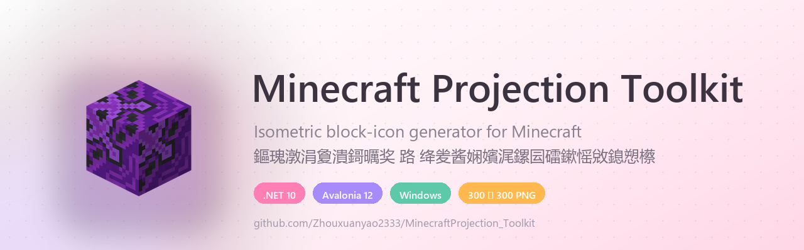
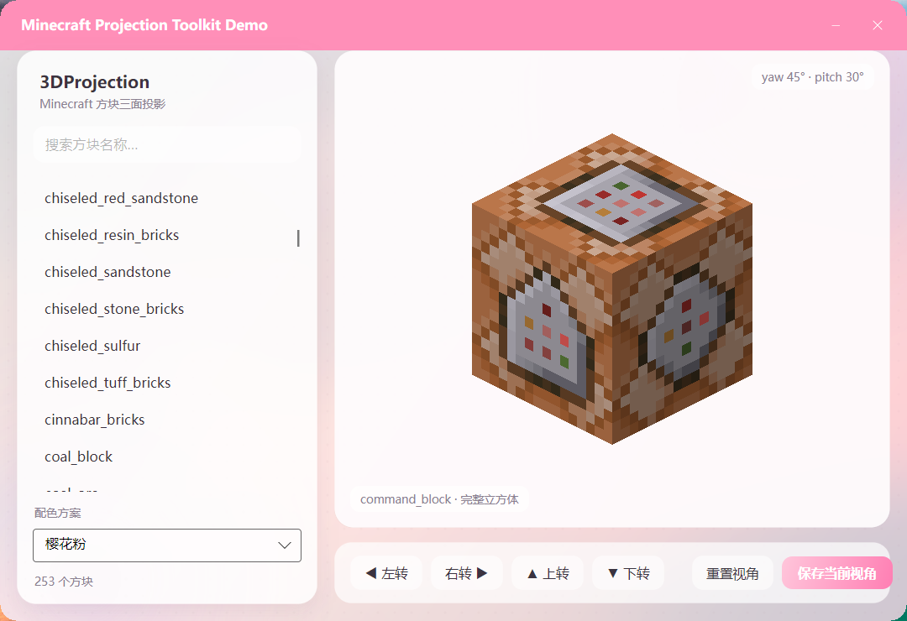
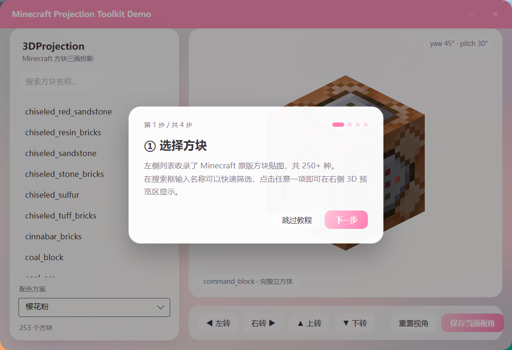
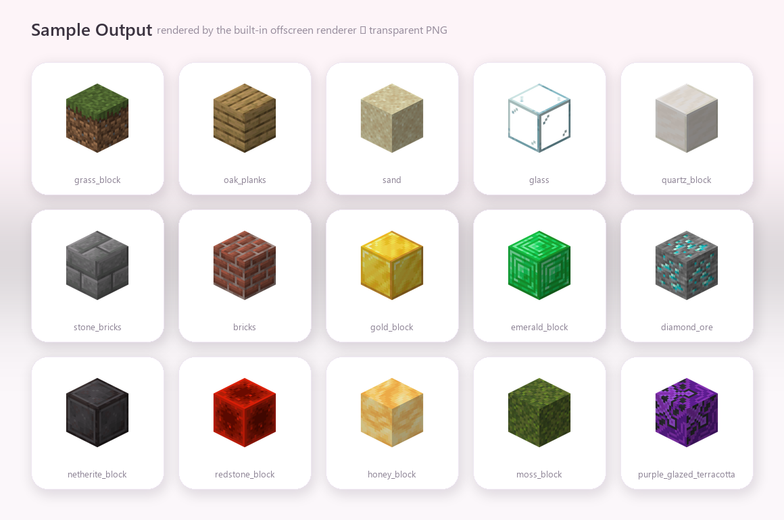
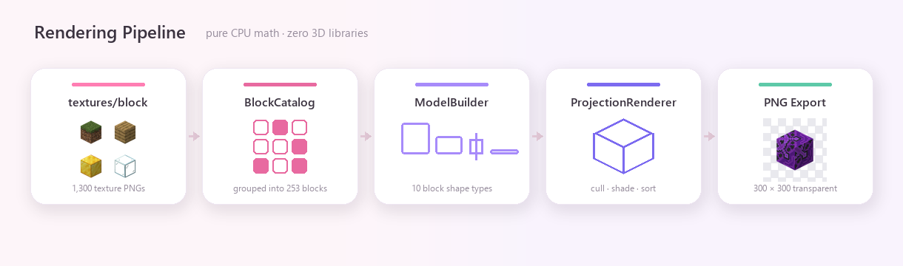

<div align="center">



<h1>Minecraft Projection Toolkit</h1>

<p><b>把 Minecraft 方块贴图，一键变成像素风的等轴测三面投影图标。</b><br/>
三面投影 · 透明背景 PNG · 300 × 300 · 所见即所得。</p>

<p>
  <a href="README.md">English</a> &nbsp;·&nbsp; <a href="README.zh-CN.md"><b>简体中文</b></a>
</p>

<p>
  <a href="https://github.com/Zhouxuanyao2333/MinecraftProjection_Toolkit/stargazers"></a>
  <a href="https://github.com/Zhouxuanyao2333/MinecraftProjection_Toolkit/forks"></a>
  <a href="https://github.com/Zhouxuanyao2333/MinecraftProjection_Toolkit/issues"></a>
  <a href="LICENSE"></a>
</p>

<p>
  
  
  
  
  
</p>

<p>
  <a href="https://github.com/Zhouxuanyao2333/MinecraftProjection_Toolkit/stargazers"></a>
  <a href="https://github.com/Zhouxuanyao2333/MinecraftProjection_Toolkit/issues/new"></a>
  <a href="https://github.com/Zhouxuanyao2333/MinecraftProjection_Toolkit/issues/new?labels=enhancement"></a>
  <a href="README.md"></a>
</p>

</div>

---

## ✨ 这是什么？

**Minecraft Projection Toolkit** 是一个 Windows 桌面工具：把 Minecraft 方块的贴图，渲染成 **等轴测（isometric）、三面可见（顶面 + 左面 + 右面）** 的图标——也就是启动器、资源包、Wiki 和方块图鉴里最常见的那种标准方块图标。

每张导出图都是 **透明背景 PNG**，可以直接丢进启动器、网页或图标集。不用 PS 手拼透视，不用去网上扒一张「差不多就行」的图。

<table>
<tr>
<td width="50%" valign="top">

**😩 以前的做法**

- 临时写个渲染脚本，跑完就丢
- 网上截别人的图标，风格不统一
- 在图像软件里手工拼三个面，慢且失真
- 每个新方块都要从头再来一遍

</td>
<td width="50%" valign="top">

**😎 现在的做法**

- 内置 **253 个方块**，支持搜索，开箱即用
- 视角实时可调：拖拽自由旋转，按钮精确 90° 翻转
- 导出 **所见即所得**，300 × 300，透明通道完整保留
- 换自己的贴图目录，程序自动重新分组

</td>
</tr>
</table>

仓库自带完整的方块贴图库；每个方块都会**按贴图命名自动拼装六面**——`grass_block_top` + `grass_block_side` + 覆盖层 + `dirt` 会自动合成一块正确的草方块，连生物群系色调都算对。

---

## 🖼 界面截图

<div align="center">



<br/><br/>



<sub>上方：实时 3D 预览主界面；下方：内置的四步新手教程。</sub>

</div>

---

## 🧱 示例输出

<div align="center">



<sub>以上每一张都是程序直接导出的：300 × 300 PNG、透明背景，无任何后期处理。</sub>

</div>

---

## 🚀 快速开始

### 环境要求

| | |
| :-- | :-- |
| **系统** | Windows 10 / 11 |
| **运行时** | [.NET 10 SDK](https://dotnet.microsoft.com/download) |
| **显卡** | 不需要——渲染是纯 CPU + Skia |
| **Minecraft** | 不需要——贴图已随仓库提供 |

### 安装与运行

```powershell
git clone https://github.com/Zhouxuanyao2333/MinecraftProjection_Toolkit.git
cd MinecraftProjection_Toolkit\.src
dotnet run
```

> **目录说明**——所有源码都在 `.src` 文件夹里；仓库根目录只放文档、许可证和 README。编译产物（`bin/`、`obj/`）已在 `.gitignore` 中排除。

### 30 秒做出第一张图标

1. **选方块**——在搜索框输入 `command_block` 并点击。
2. **转视角**——按住鼠标左键拖拽，或用 `◀ ▶ ▲ ▼` 精确转 90°。
3. **换配色**——左下角「配色方案」切换主题。
4. **导出**——点击 **保存当前视角**，选择路径，得到 300 × 300 的透明 PNG。

---

## 🎮 使用教程

### 1 · 选择方块
左侧列表会扫描 `textures/block` 目录，把零散的面贴图**自动归组为 253 个完整方块**。搜索框支持按名称过滤（`stone`、`ore`、`terracotta`、`glass`…），点击任意一项即可载入右侧预览。

### 2 · 旋转视角
| 操作 | 方式 |
| :-- | :-- |
| 自由旋转 | 在预览区**按住鼠标左键拖拽** |
| 水平 90° 翻转 | **◀ 左转** / **右转 ▶** |
| 垂直 90° 翻转 | **▲ 上转** / **▼ 下转** |
| 回到默认视角 | **重置视角** |
| 默认相机 | `yaw 45°` · `pitch 30°`（经典 2:1 等轴测视角） |

当前角度会实时显示在右上角，**导出时用的就是这个视角**。

### 3 · 切换配色
三套预设——樱花粉、薰衣草、薄荷青——会整体重绘界面：渐变背景、标题栏、强调按钮、选中高亮全部跟着变。

### 4 · 导出图片
点击 **保存当前视角** → 选择保存位置 → 程序用离屏渲染输出 **300 × 300**、`FillFactor 0.82` 的 PNG，多张图标并排时大小和间距一致。

> **小技巧**
> - 默认文件名是 `<方块名>.png`，建议保留，和目录名保持一致方便批量管理。
> - 导出图**完全透明**：界面的渐变背景不会被烤进图片。
> - 任何一个角度都可以重新导出，预览和文件永远一致。
> - 首次启动的欢迎弹窗里点「开始教程」，可以在应用内走一遍同样的四步。

---

## ⚙️ 自定义

<table>
<tr><th align="left">改什么</th><th align="left">在哪</th><th align="left">怎么改</th></tr>
<tr>
<td><b>导出分辨率</b></td>
<td><code>.src/ViewUI/MainWindow.axaml.cs</code></td>
<td>修改 <code>private const int ExportSize = 300;</code></td>
</tr>
<tr>
<td><b>配色 / 主题</b></td>
<td><code>.src/ViewUI/ThemeConfig.cs</code> + <code>ApplyPreset()</code></td>
<td>调整渐变色标、强调色、标题栏颜色、圆角</td>
</tr>
<tr>
<td><b>相机取景比例</b></td>
<td><code>Camera.FillFactor</code>（导出时 0.82）</td>
<td>调小 = 方块在画布中更小、留白更多</td>
</tr>
<tr>
<td><b>换成自己的贴图</b></td>
<td><code>.src/textures/block/*.png</code></td>
<td>把贴图 PNG 丢进去，重启后自动重新分组</td>
</tr>
<tr>
<td><b>列表收录哪些方块</b></td>
<td><code>.src/Toolkits/Textures/BlockCatalog.cs</code> → <code>AllowedSuffixes</code></td>
<td>增加后缀即可收录更多方块类型</td>
</tr>
</table>

---

## 🔬 实现原理

<div align="center">

</div>

这里**没有用任何 3D 引擎**，整条管线都是手写的：

| 阶段 | 文件 | 职责 |
| :-- | :-- | :-- |
| **目录归组** | `Toolkits/Textures/BlockCatalog.cs` | 扫描贴图目录，把 `_top` / `_side` / `_front` 等面贴图归组为方块定义，并推断几何类型 |
| **贴图装配** | `Toolkits/Textures/BlockTextureSet.cs` | 加载与缓存六面贴图，合成带生物群系色调的草方块、雪地草方块，以及裁掉透明边的花草 |
| **几何建模** | `Toolkits/Model/ModelBuilder.cs` | 支持 10 种形状：立方体、半砖、薄板、扁平层、十字交叉、细柱、贴墙平面、小方块、锥形、床 |
| **投影渲染** | `Toolkits/Render/ProjectionRenderer.cs` | yaw/pitch 旋转 → 正交投影 → **背面剔除** → **兰伯特光照** → 画家算法深度排序 |
| **光栅化** | `Toolkits/Render/SkiaFacePainter.cs` | 用 SkiaSharp 逐面绘制，贴图**最近邻采样**，像素清晰不糊 |
| **导出** | `Toolkits/Render/OffscreenRenderer.cs` | 渲染到离屏 `SKBitmap`，编码为透明 PNG |

**技术亮点**

- 🎯 **正交投影**——`pitch = 30°` 时顶面正好是 2:1，这是 Minecraft 社区方块图标的标准比例。
- 🧠 **形状感知建模**——不是所有方块都是立方体：半砖、薄板、十字平面、锥形各有自己的几何，图标才不违和。
- 🌿 **生物群系染结合成**——草/树叶贴图在素材里是灰度图，工具会按正确群系色相乘，并叠加侧面覆盖层，与游戏内表现一致。
- ⚡ **零 3D 依赖**——数学只用 `System.Numerics`，光栅化只用 SkiaSharp；核心渲染器约 160 行，一次就能读完。
- 🪶 **启动即用**——253 个方块目录只靠文件名构建，贴图按选中项懒加载。

---

## 🗂 项目结构

```text
MinecraftProjection_Toolkit/
├── .src/                          # 全部参与编译的源码
│   ├── 3dproj.csproj              # .NET 10 · Avalonia 12.1 · SkiaSharp 3.119
│   ├── Program.cs                 # Avalonia 入口
│   ├── App.axaml(.cs)             # Fluent 主题、字体、资源画刷
│   ├── app.manifest
│   ├── Toolkits/
│   │   ├── Maths/Vec.cs
│   │   ├── Model/                 # BlockShape · CubeModel · ModelBuilder · SpecialModels
│   │   ├── Render/                # ProjectionRenderer · SkiaFacePainter · OffscreenRenderer
│   │   └── Textures/              # BlockCatalog · BlockTextureSet
│   ├── ViewUI/
│   │   ├── MainWindow.axaml(.cs)  # 窗口、方块列表、旋转、导出、新手引导
│   │   ├── BlockViewer.cs         # 可交互预览控件
│   │   ├── ThemeConfig.cs         # 外观参数
│   │   └── GUIMainIMG/            # 图标与装饰光晕/点阵
│   ├── textures/                  # 随仓库附带的 Minecraft 素材（block/ item/ entity/ …）
│   ├── HANDOVER.md                # 设计与接手说明
│   └── RENDER_PIPELINE.md         # 渲染管线深度文档
├── docs/assets/                   # README 配图
├── .gitignore                     # 排除 bin/ · obj/ · IDE 文件
└── LICENSE
```

---

## ❓ 常见问题

<details>
<summary><b>为什么只有 253 个方块？我的贴图目录里明明更多。</b></summary>

目录只收录「能构成完整方块」的贴图族（后缀如 `_block`、`_ore`、`_planks`、`_wool`、`_glass`、`_terracotta`…）。这样会自动排除物品、粒子、实体皮肤和纯覆盖层文件，保证列表里每一行都真的能渲染。想收录更多，改 `BlockCatalog.cs` 里的 `AllowedSuffixes` 即可。

</details>

<details>
<summary><b>导出的图标保留透明吗？</b></summary>

保留。导出时会先把画布清成完全透明，再以 100% 质量写入 Alpha 通道——没有背景、没有阴影、没有界面元素。

</details>

<details>
<summary><b>这是 Minecraft 模组或启动器插件吗？</b></summary>

不是。它是一个独立的 Windows 桌面应用，只从磁盘读取 PNG 贴图来生成图标素材，不会连接或改动你的 Minecraft 安装。

</details>

<details>
<summary><b>支持 macOS / Linux 吗？</b></summary>

Avalonia 本身跨平台，渲染内核也是可移植的；但亚克力模糊、窗口圆角裁剪、自绘标题栏这些效果目前是 Windows 专用实现。正式支持的目标平台是 Windows 10 / 11。

</details>

---

## 🗺 路线图

- [x] 253 方块目录与自动六面归组
- [x] 形状感知几何建模（10 种方块形状）
- [x] 自由旋转 + 精确 90° 翻转
- [x] 三套配色、亚克力窗口、动效
- [x] 透明 300 × 300 PNG 导出
- [ ] 批量导出（多选 → 文件夹 / ZIP）
- [ ] 界面内自定义分辨率与取景比例
- [ ] CLI / 无头模式（方便接入构建流水线）
- [ ] 物品与实体图标支持
- [ ] macOS / Linux 适配完善

---

## 🤝 参与贡献

欢迎提 Issue、提想法、直接发 PR。

1. Fork 本仓库
2. 新建分支：`git checkout -b feat/your-feature`
3. 提交：`git commit -m "feat: add your feature"`
4. 推送并创建 Pull Request

请保持现有代码风格：C# + XML 文档注释；界面代码放 `ViewUI/`，渲染逻辑放 `Toolkits/`；不要引入重量级新依赖。

---

## ⭐ 支持

如果这个工具帮你省了时间，点个 Star 就是最大的支持 💗

<a href="https://github.com/Zhouxuanyao2333/MinecraftProjection_Toolkit/stargazers"></a>

---

## 📜 许可证

本项目基于 [MIT License](LICENSE) 开源。

> **声明**——本项目是非官方社区工具，与 Mojang Studios 及 Microsoft 无任何隶属或背书关系。`textures/` 下的 Minecraft 素材版权归 Mojang Studios 所有，仅为「开箱即用」而附带，不在 MIT 许可证覆盖范围内。

<div align="center">
<sub>用 <b>.NET 10</b> · <b>Avalonia</b> · <b>SkiaSharp</b> 打造——以及大量像素级的偏执。</sub>
</div>
